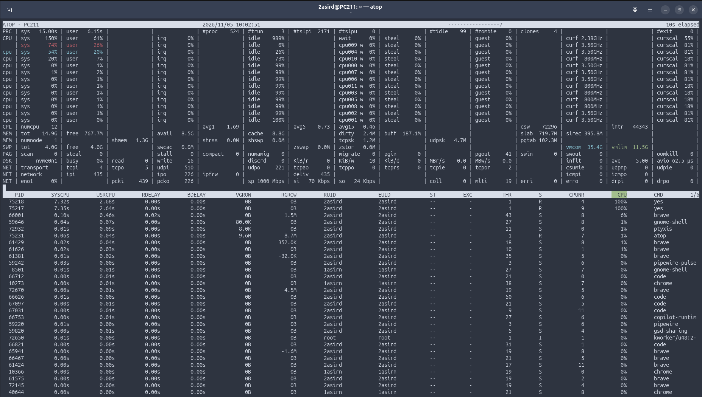

# 1. Monitorización de Procesos

En este documento se recogen los principales comandos y herramientas en Linux (`ps`, `top`, `htop` y `atop`) para visualizar, filtrar y monitorizar en tiempo real los procesos del sistema.

---

## 1. Comando `ps` (Process Status)

El comando `ps` muestra una instantánea de los procesos actuales del sistema en el momento de su ejecución.

### `ps a`
* **¿Qué hace?**: Muestra información de los procesos activos asociados a una terminal (`TTY`), incluyendo los de otros usuarios.

  

---

### `ps au`
* **¿Qué hace?**: Muestra los procesos activos en las terminales de todos los usuarios añadiendo un **formato orientado al usuario** (`u`), que detalla quién ejecuta el proceso (`USER`), porcentaje de procesador (`%CPU`), porcentaje de memoria (`%MEM`), tamaño de memoria virtual (`VSZ`), memoria física residente (`RSS`), estado (`STAT`) y hora de inicio (`START`).

  

---

### `ps aux`
* **¿Qué hace?**: Muestra **todos los procesos del sistema**, combinando:
  * `a`: Procesos de todos los usuarios con terminal.
  * `u`: Formato detallado orientado al usuario (`%CPU`, `%MEM`, `USER`, etc.).
  * `x`: Incluye los procesos que **no están asociados a ninguna terminal** (como demonios y servicios del sistema en segundo plano, identificados con `?` en la columna `TTY`).

  

---

### Filtrado de procesos (`ps -C`, `ps u -C`, `ps -u`)
* **`ps -C "Nombre_del_proceso"`** *(ej. `ps -C nano`)*: Filtra y busca procesos por el nombre exacto del comando ejecutable, mostrando información básica (`PID`, `TTY`, `TIME`, `CMD`).
* **`ps u -C "Nombre_del_proceso"`** *(ej. `ps u -C nano`)*: Busca un proceso por su nombre exacto y además muestra el detalle de consumo de recursos y propietario gracias al modificador `u`.
* **`ps -u "usuario"`** *(ej. `ps -u alumno`)*: Filtra y lista únicamente los procesos que pertenecen al usuario especificado.

  

---

## 2. Comando `top`

### `top`
* **¿Qué hace?**: Muestra en **tiempo real** y de forma interactiva los procesos que se están ejecutando en el sistema, junto con un resumen superior del estado general: tiempo encendido (*uptime*), carga media (*load average*), total de tareas, uso de CPU y consumo de memoria RAM e intercambio (*Swap*).

  

### Atajos interactivos en `top`
Mientras `top` está en ejecución, podemos pulsar las siguientes combinaciones de teclas para ordenar la lista de procesos:

| Atajo | Acción |
| :--- | :--- |
| **`Shift + M`** | Ordena los procesos por consumo de **memoria (`%MEM`)** de mayor a menor. |
| **`Shift + P`** | Ordena los procesos por consumo de **CPU (`%CPU`)** de mayor a menor *(orden por defecto)*. |
| **`Shift + T`** | Ordena los procesos por **tiempo acumulado de uso de CPU (`TIME+`)**. |
| **`Shift + N`** | Ordena los procesos por su **identificador numérico (`PID`)**. |
| **`Shift + R`** | **Invierte el orden** actual (si está de mayor a menor, pasa a mostrarse de menor a mayor, y viceversa). |

---

### Ejercicio 1: Reporte con `top` en modo lote (*batch*)

> **Enunciado:** Utilizando el comando `top`, necesitamos mandar a nuestro jefe de proyecto un listado de los 10 procesos que consumen más CPU durante 3 periodos consecutivos.

* **`top -b -n 3 > top.info`** *(o filtrando los 10 primeros procesos con `top -b -n 3 -d 3 -o %CPU | awk '/PID/ {count=0; print; next} count<10 && count!="" {print; count++}' > reporte_procesos.txt`)*:
  * `-b` (*Batch mode*): Ejecuta `top` en modo no interactivo, ideal para volcar o redirigir la salida a un archivo de texto (`> top.info`) o a otro comando.
  * `-n 3` (*Number of iterations*): Indica que capture exactamente **3 periodos/iteraciones** consecutivas antes de finalizar automáticamente.
  * `-d 3` *(opcional)*: Define el intervalo de refresco en segundos entre cada periodo.
  * `-o %CPU` *(opcional)*: Asegura que la salida esté ordenada por consumo de procesador.

  

---

## 3. Comando `htop`

### `htop`
* **¿Qué hace?**: Es un visor de procesos interactivo y mejorado respecto a `top`. Ofrece una interfaz visual a color con barras de progreso para cada hilo/núcleo de la CPU, memoria RAM y Swap, además de permitir desplazarse vertical y horizontalmente, usar el ratón y gestionar procesos (filtrar, buscar, cambiar prioridad o matarlos) mediante las teclas de función (`F1` a `F10`).

  

---

## 4. Comando `atop` y pruebas de estrés

### `atop`
* **¿Qué hace?**: Es un monitor avanzado de rendimiento a pantalla completa que registra tanto la actividad de los procesos como el uso global de hardware (**CPU por núcleo, memoria, disco `DSK` y red `NET`**). Además, corre como servicio en segundo plano guardando registros históricos diarios en `/var/log/atop/`.

  

### Comandos y opciones utilizadas con `atop`

* **Gestión del servicio y configuración (`/etc/default/atop`)**:
  * `sudo systemctl status atop` / `sudo systemctl restart atop`: Comprueba el estado o reinicia el servicio encargado de registrar la actividad del sistema.
* **Lectura de registros históricos**:
  * `atop -r /var/log/atop/atop_YYYYMMDD`: Abre un archivo de registro histórico guardado por `atop` para analizar qué ocurrió en el sistema en momentos pasados.
* **Teclas interactivas dentro de `atop`**:
  * **`t`**: Avanza al siguiente intervalo de tiempo registrado en el archivo de log.
  * **`Shift + T`**: Retrocede al intervalo de tiempo anterior en el registro.
  * **`c`**: Ordena los procesos por consumo de CPU.
  * **`m`**: Ordena los procesos por consumo de memoria.
  * **`d`**: Ordena los procesos por actividad de disco.
* **Comandos auxiliares de prueba de carga (visibles en la captura)**:
  * `nproc`: Muestra el número de unidades de procesamiento (núcleos/hilos) disponibles en el sistema.
  * `for i in 1 2; do yes > /dev/null & done`: Lanza 2 procesos `yes` en segundo plano redirigiendo su salida a `/dev/null` para generar una carga del 100% en 2 núcleos de CPU y observar su impacto en `atop` / `htop`.
  * `pkill -9 yes`: Envía la señal `SIGKILL` (`-9`) para terminar forzosamente todos los procesos llamados `yes`.
