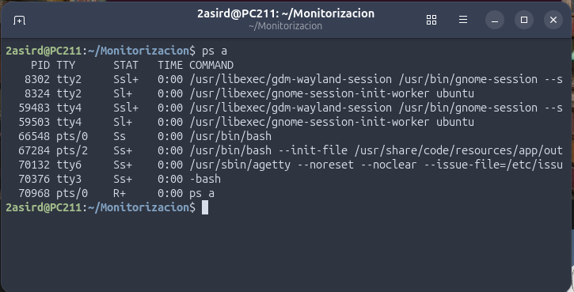
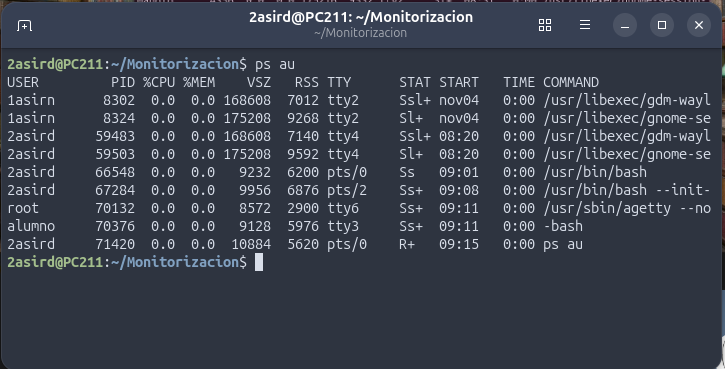
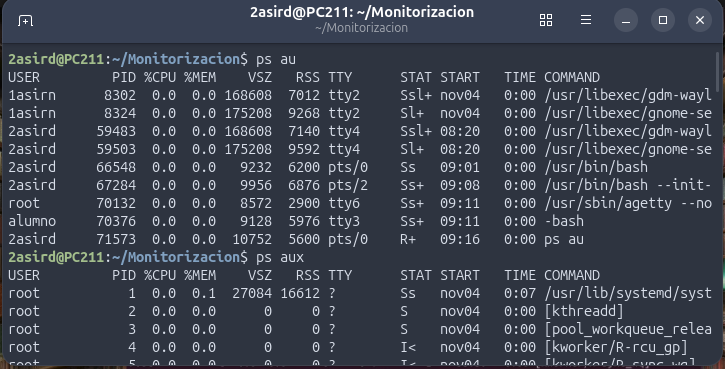
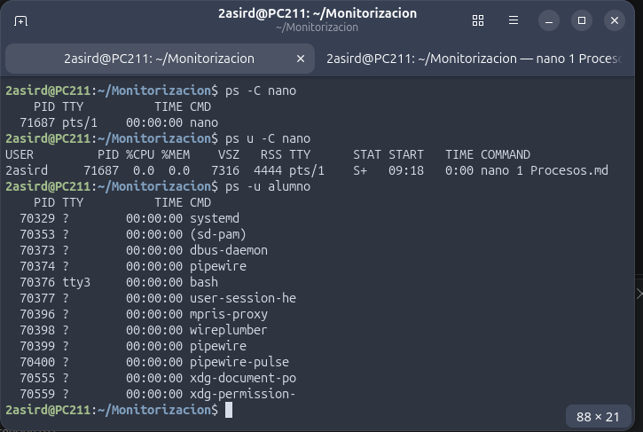
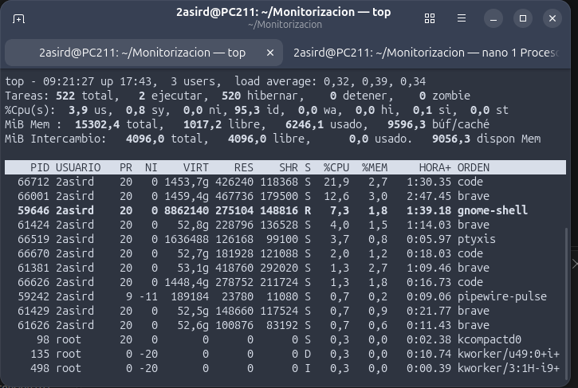
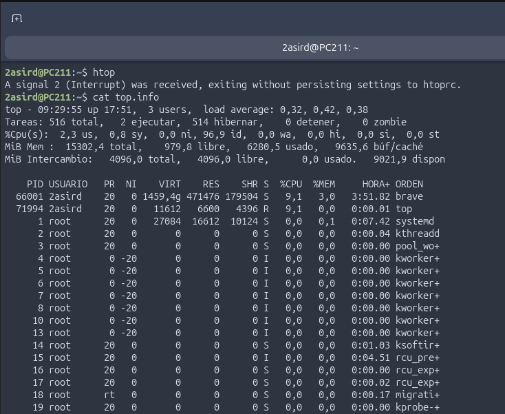
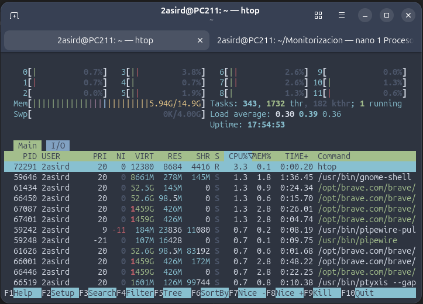

# Procesos

ps a: Muestra informacion de los procesos activos

ps au: Muestra los procesos activos de todos los usuarios y utiliza un formato legible para el ser humano

ps aux: Muestra todos los procesos, incluidos los del sistema

ps -C "Nombre del proceso":

top:

htop:
## Opciones

### top
- shft + M: Ordena por memoria de mayor a menor
- shft + P: ordena por CPU de mayor a menor
- shft + T: Ordena por tiempo de uso
- shft + N: Ordena por numero de identificador
- shft + R: Te lo ordena al contrario de la ultima      
  opcion (es decir si esta de mayor a menor, se hace de menor a mayor)

### Ejercicio 1

utilizando el comando top necesitamos mandar a nuestro jefe de proyecto un listado de los 10 procesos que consumen mas CPU durante 3 periodos consecutivos
